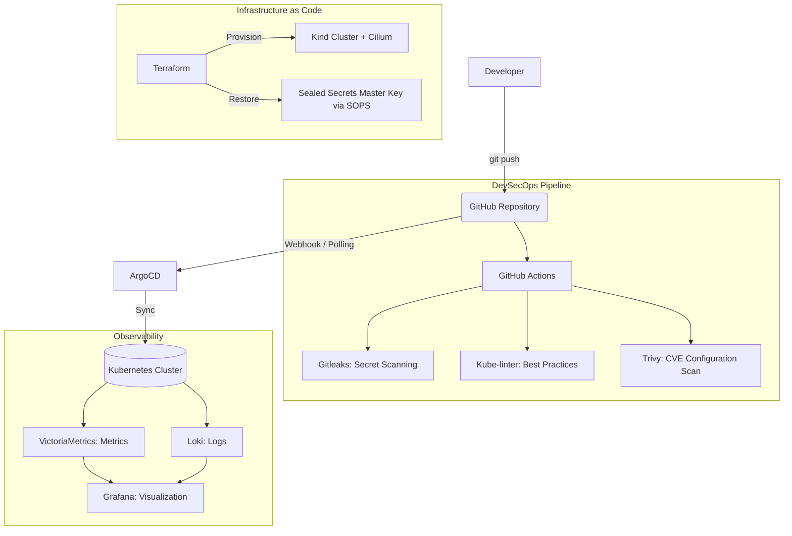

# Kubernetes GitOps Platform

Платформа для развертывания и управления Kubernetes-приложениями. Проект реализует принципы GitOps, Infrastructure as Code (IaC) и DevSecOps, обеспечивая высокую степень автоматизации, безопасности и наблюдаемости.

## Содержание

- [Обзор](#обзор)
- [Архитектура](#архитектура)
- [Стек технологий](#стек-технологий)
- [Структура репозитория](#структура-репозитория)
- [Предварительные требования](#предварительные-требования)
- [Установка и использование](#установка-и-использование)
- [Безопасность и DevSecOps](#безопасность-и-devsecops)
- [Наблюдаемость (Observability)](#наблюдаемость-observability)
- [Аварийное восстановление (Disaster Recovery)](#аварийное-восстановление-disaster-recovery)
- [Масштабирование на Production](#масштабирование-на-production)
- [Решение проблем (Troubleshooting)](#решение-проблем-troubleshooting)
- [Внесение изменений (Contributing)](#внесение-изменений-contributing)
- [Лицензия](#лицензия)

---

## Обзор

Данный проект представляет собой реализацию платформы для управления Kubernetes-кластером. Основной принцип архитектуры — Single Source of Truth (Единый источник истины). Любое изменение, будь то обновление версии приложения, изменение сетевых политик или масштабирование инфраструктуры, инициируется исключительно через коммит в Git-репозиторий.

Платформа обеспечивает полный цикл жизни приложения: от проверки кода на уязвимости в CI/CD до автоматического развертывания через ArgoCD и мониторинга состояния в реальном времени. Особое внимание уделено безопасности: все секреты зашифрованы, контейнеры запускаются с минимальными привилегиями, а инфраструктурный код полностью воспроизводим.

---

## Архитектура

Проект построен на основе событийно-ориентированной модели (Pull-модель GitOps).




---

## Стек технологий

| Категория | Инструменты | Назначение |
| :--- | :--- | :--- |
| **Инфраструктура** | Terraform, Kind (Kubernetes in Docker) | Декларативное описание и создание кластера (IaC). |
| **Сеть** | Cilium | Современный CNI на базе eBPF, полная замена kube-proxy. |
| **GitOps** | ArgoCD | Непрерывная доставка и синхронизация состояния (паттерн App of Apps). |
| **Безопасность** | Bitnami Sealed Secrets, SOPS (age) | Асимметричное шифрование секретов и Disaster Recovery. |
| **DevSecOps CI/CD** | GitHub Actions, Gitleaks, Kube-linter, Trivy | Автоматическая блокировка небезопасного кода до попадания в кластер. |
| **Пакетирование** | Helm v3 | Управление шаблонами развертывания приложений. |
| **Наблюдаемость** | VictoriaMetrics, Loki, Grafana | Сбор метрик, агрегация логов и визуализация данных. |

---

## Структура репозитория

В данном проекте используется подход Monorepo. Выбран осознанно для обеспечения атомарности изменений, упрощения управления зависимостями и создания единой точки истины для демонстрации полного цикла.

```text
.
├── .github/workflows/      # DevSecOps CI/CD пайплайны
├── root-app.yaml           # Корневое приложение (App of Apps)
├── apps/                   # ArgoCD Application манифесты (разделены по окружениям)
│   ├── dev/                # Конфигурации для окружения разработки
│   └── prod/               # Конфигурации для производственного окружения
├── charts/nginx-app/       # Helm-чарт приложения с security best practices
├── monitoring/             # Конфигурация стека наблюдаемости (VictoriaMetrics + Loki)
├── secrets/                # Зашифрованный мастер-ключ Sealed Secrets (SOPS)
├── terraform/              # Infrastructure as Code (модули и окружения)
├── bootstrap.sh            # Скрипт полной автоматизации развертывания
├── Makefile                # Утилиты для быстрой разработки и валидации
├── CHANGELOG.md            # История изменений проекта
└── SECURITY.md             # Политика безопасности
```

## Предварительные требования

Для локального развертывания и управления платформой необходимы следующие инструменты:
* **Terraform** `>= 1.9.0`
* **kubectl** `>= 1.31.0`
* **Helm** `>= 3.15.0`
* **Docker** `>= 24.0` (необходим для работы Kind)
* **SOPS** `>= 3.8.0` и **age** (для управления ключами шифрования)

---

## Установка и использование

### Быстрый старт (Bootstrap)

Для развертывания всей платформы выполните одну команду. Скрипт автоматически создаст кластер, восстановит ключи шифрования и инициализирует GitOps-движок.

```bash
# Инициализация через Makefile:
make bootstrap

# Или запуск скрипта напрямую:
./bootstrap.sh
```

---

## Ручной доступ к интерфейсам

После успешного выполнения скрипта используйте следующие команды для проброса портов:

### ArgoCD UI
* **Проброс порта:**
  ```bash
  kubectl port-forward svc/argocd-server -n argocd 8080:80
  ```
* **URL:** [http://localhost:8080](http://localhost:8080)
* **Логин:** `admin`
* **Пароль** (получить команду для генерации):
  ```bash
  kubectl -n argocd get secret argocd-initial-admin-secret -o jsonpath="{.data.password}" | base64 -d
  ```

### Grafana UI
* **Проброс порта:**
  ```bash
  kubectl port-forward svc/vm-stack-grafana -n monitoring 3000:80
  ```
* **URL:** [http://localhost:3000](http://localhost:3000)
* **Логин:** `admin`
* **Пароль:** `admin123`

> [!NOTE]
> **Примечание:** Учетные данные `admin123` для Grafana заданы в файле `monitoring/vm-values.yaml` исключительно для упрощения локального развертывания и демонстрации.
> 
> В production-среде использование статических паролей в коде недопустимо. Для управления секретами должны использоваться специализированные решения, такие как **HashiCorp Vault**, **External Secrets Operator** или интеграция с корпоративным SSO (OIDC/SAML).

---

## Безопасность и DevSecOps

* **Шифрование секретов:** Все чувствительные данные шифруются с помощью **Bitnami Sealed Secrets**. Мастер-ключ контроллера зашифрован через **SOPS (age)** и безопасно хранится в репозитории, что обеспечивает возможность *Disaster Recovery*.
* **Защита периметра кода (Shift-Left):** CI/CD пайплайн автоматически блокирует любые merge request, содержащие:
  * Утечки секретов или токенов (**Gitleaks**).
  * Нарушения лучших практик Kubernetes, такие как отсутствие лимитов ресурсов (**Kube-linter**).
  * Известные уязвимости в конфигурациях (**Trivy**).
* **Безопасность runtime:** Контейнеры приложений запускаются с непривилегированными правами (`runAsNonRoot: true`, `readOnlyRootFilesystem: true`), с жестко заданными лимитами ресурсов и правилами *Pod Anti-Affinity* для обеспечения высокой доступности.
* **Изоляция ключей:** Приватные ключи шифрования (`age`) никогда не коммитятся в репозиторий и хранятся исключительно локально у администратора.

---

## Наблюдаемость (Observability)

Платформа включает в себя легкий и современный стек мониторинга, развернутый декларативно через **ArgoCD**:
* **VictoriaMetrics:** Сбор и хранение метрик (совместим с Prometheus API).
* **Loki:** Агрегация и хранение логов.
* **Grafana:** Единая панель управления для визуализации метрик кластера, состояния подов и потоков логов в реальном времени.

---

## Аварийное восстановление (Disaster Recovery)

Архитектура платформы устойчива к полной потере кластера. Процесс восстановления выглядит следующим образом:
1. Развертывание нового кластера с помощью `terraform apply`.
2. Скрипт `restore-secrets.sh` (вызываемый через `terraform_data`) автоматически расшифровывает файл `secrets/master-key.dev.enc.yaml` с использованием локального приватного ключа `age`.
3. Расшифрованный мастер-ключ применяется в кластер до запуска контроллера **Sealed Secrets**.
4. **ArgoCD** синхронизирует состояние, и контроллер **Sealed Secrets** успешно расшифровывает все `SealedSecret` манифесты из Git, используя восстановленный ключ.

---

## Масштабирование на Production

Для разделения окружений (*Dev/Prod*) в проекте используется изоляция на уровне *ArgoCD Applications* и переопределение параметров через *Helm values*. 

Инфраструктурный код (**Terraform**) вынесен в переиспользуемые модули, что позволяет легко адаптировать его для управляемых облачных провайдеров (**AWS EKS**, **Yandex Managed Kubernetes**) путем замены провайдера `kind` на соответствующий облачный модуль, сохраняя при этом всю логику GitOps и безопасности.

---

## Решение проблем (Troubleshooting)

* **ArgoCD показывает статус "OutOfSync" или "Missing":** Убедитесь, что неймспейс назначения существует (флаг `CreateNamespace=true` в `syncOptions`) и что CRD для используемых ресурсов (например, `SealedSecret`) установлены в кластере.
* **Terraform не видит изменения в количестве нод:** Проверьте блок `lifecycle { ignore_changes }` в модуле Terraform. Для изменения топологии кластера Kind может потребоваться его пересоздание (`terraform destroy -> terraform apply`).
* **Pod в статусе OOMKilled:** Проверьте `requests` и `limits` в Helm values. Для локальных сред Kind значения должны быть минимальными (например, `limits.memory: 256Mi` для Grafana).

---

## Внесение изменений (Contributing)

1. Создайте feature-ветку от `main`.
2. Внесите изменения в Helm-чарты или Terraform-модули.
3. Выполните локальную валидацию: `make lint` и `make test`.
4. Откройте *Pull Request*. Пайплайн **GitHub Actions** автоматически проверит код на соответствие стандартам безопасности. Merge возможен только при успешном прохождении всех проверок.

---

## Лицензия

Данный проект распространяется под лицензией **MIT**. Подробности см. в файле `LICENSE`.

